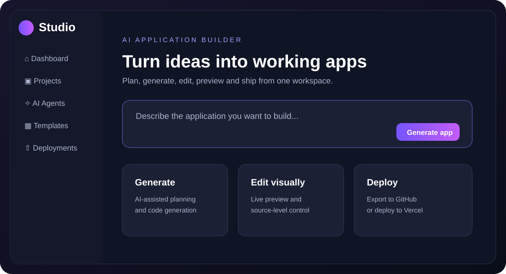
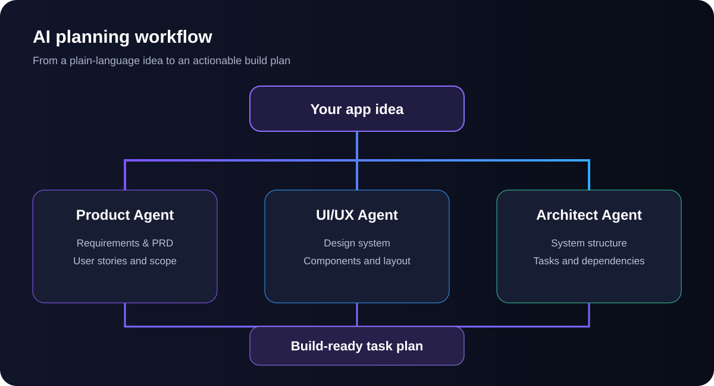
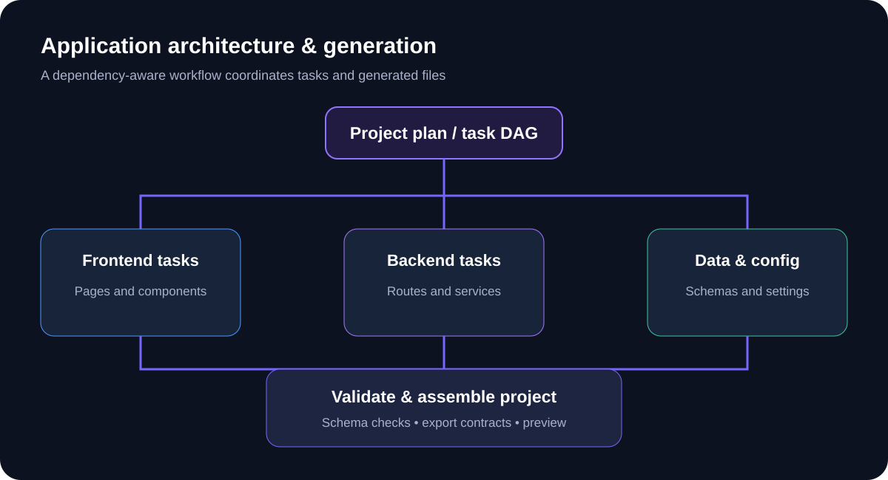
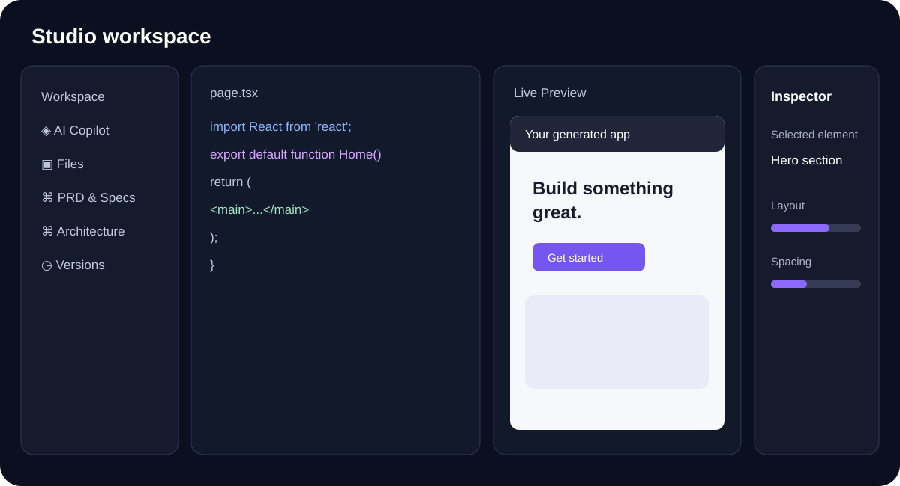

# Studio

**Build applications from ideas, with AI.**

Studio is an AI-powered application builder that helps turn a plain-language prompt into a planned, generated, editable application. It brings AI-assisted planning, code generation, live preview, visual editing, and project export into one workspace.

> The visuals below are conceptual illustrations created for this README to explain Studio's workflow. They are not captured screenshots of the running application.

## What is Studio?

Building an application usually means moving between product planning, UI design, coding, testing, and deployment. Studio brings these steps into one guided workspace so developers can move from an idea to a working starting point faster while keeping control of the generated code.

## How it works



1. **Describe** — enter the application idea in natural language.
2. **Plan** — AI agents help shape requirements, the design system, architecture, and build tasks.
3. **Generate** — execute tasks to generate project files.
4. **Refine** — inspect the live preview, edit code, and request targeted changes through AI chat or supported visual controls.
5. **Ship** — export the project as a ZIP, push it to GitHub, or deploy through Vercel.

## AI-assisted planning



Studio uses specialized planning roles to break an idea into useful implementation inputs:

- **Product Agent** — requirements, scope, and product specification.
- **UI/UX Agent** — design direction, design tokens, and interface structure.
- **Architect Agent** — application structure and dependency-aware build tasks.

Choose **Guided** mode when you want approval checkpoints, or **Autonomous** mode to let the workflow proceed without those checkpoints.

## From plan to project files



The generated plan is organized as tasks with dependencies. Studio executes tasks file by file, supplies relevant dependency context, validates structured AI responses, and checks expected exports before returning generated files to the workspace.

## One workspace to build and refine



The workspace brings together:

- **Live preview** — inspect the generated application and switch responsive viewport presets.
- **Code editor** — browse project files and edit source with Monaco.
- **AI Copilot** — request focused changes in natural language.
- **Visual inspector** — select supported elements and adjust text or styling.
- **PRD and DAG views** — review requirements and the task dependency graph.
- **Checkpoints** — snapshot and restore project versions when Firebase persistence is configured.
- **Export and deployment** — package the project, export to GitHub, or deploy to Vercel.

## Built with

| Area | Technology |
| --- | --- |
| Framework | Next.js App Router |
| Language | TypeScript |
| UI | React, Tailwind CSS, Radix UI |
| Code editor | Monaco Editor |
| Preview | CodeSandbox Sandpack |
| AI providers | Google Gemini, Groq |
| Validation | Zod |
| Persistence | Firebase Authentication, Firestore, Firebase Admin (optional) |
| Code transformation | TypeScript/JSX-aware patch utilities |
| Export | JSZip, Octokit |
| Deployment | Vercel Deployments API |

## Run locally

```bash
git clone https://github.com/Aravindkumar5500/Studio.git
cd Studio
npm install
cp .env.example .env.local
npm run dev
```

Open [http://localhost:3000](http://localhost:3000).

Configure the provider credentials and Firebase settings you need in your local `.env.local` file. Firebase-backed persistence is optional for the in-memory demo path. Never commit real service credentials or private API tokens.

## Project status

Studio is an actively developed project. AI-generated code still needs review and testing before production use. Available workflows depend on configured provider credentials, Firebase setup, and the permissions granted to GitHub or Vercel during export and deployment.

---

**Explore the code:** [GitHub repository](https://github.com/Aravindkumar5500/Studio)
